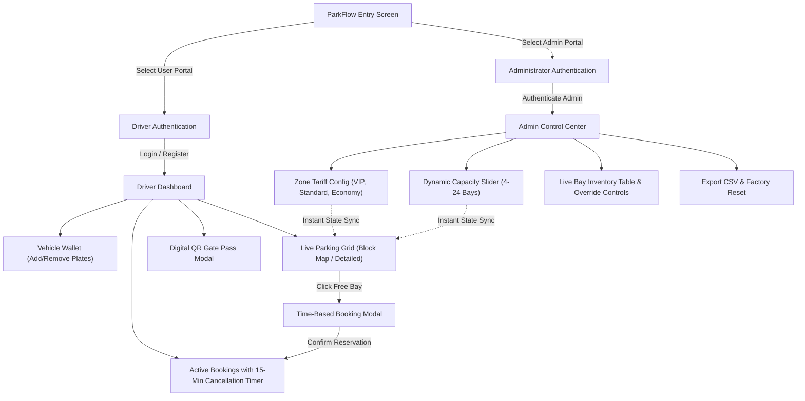

# 🅿️ ParkFlow — Smart Car Parking Management System

[](https://developer.mozilla.org/en-US/docs/Web/HTML)
[](https://tailwindcss.com/)
[](https://developer.mozilla.org/en-US/docs/Web/JavaScript)
[](https://opensource.org/licenses/MIT)
[](https://github.com/)

> **ParkFlow** is an autonomous, full-featured Smart Parking Management single-page web application. Built with pure modern HTML5, Tailwind CSS, and reactive Vanilla JavaScript, it offers real-time slot allocation, multi-vehicle wallet tracking, zone-based dynamic pricing, digital QR gate pass generation, and administrator operations orchestration—**with zero build tools, node dependencies, or complex setup required.**

---

## 🌟 Key Features

### 1. 🚪 Dual-Portal Architecture
* **User Portal**: Dedicated interface for drivers to browse real-time slot availability, manage multiple vehicles, book bays with specific time durations, and generate digital access passes.
* **Administrator Portal**: Restricted facility operations control center with administrative overrides, live inventory monitoring, dynamic bay scaling, and CSV data exports.

### 2. 🔐 Authentication & Multi-Vehicle Wallet
* **Driver Registration & Sign In**: Driver onboarding collecting Full Name, Username, Password, and primary vehicle profile with classification (Sedan, SUV, EV, Hatchback, Van/Truck, Motorcycle).
* **Multi-Vehicle Profile Management**: Drivers can add and manage multiple license plates simultaneously under one user profile and select which vehicle to park in each bay.
* **Double-Booking Prevention**: Prohibits simultaneous reservations for the same vehicle across different bays.
* **Administrator Credentials**: Preconfigured high-security operations gateway with single-click demo autofill.

### 3. 🗺️ Dual-View Live Parking Grid
* **Visual Block Map**: Instant color-coded bay status:
  * 🟢 **Emerald (Green)**: Free & available for immediate booking.
  * 🔴 **Rose (Red)**: Currently occupied by another driver.
  * 🔵 **Blue**: Occupied by your own active reservation (with quick cancel / pass actions).
* **Detailed Inventory Cards**: Displays bay code, zone badge, active tariff, amenities (EV fast chargers, covered stall, security cameras), and quick-action triggers.
* **Zone Classification**:
  * 👑 **VIP Zone (Row 1 / Slots 1–4)**: Priority entrance, dedicated EV chargers.
  * 🛡️ **Standard Zone (Row 2 / Slots 5–8)**: Covered canopy stalls with CCTV.
  * 🍃 **Economy Zone (Rows 3+ / Slots 9–24)**: Perimeter self-park stalls.
* **Dynamic Zone & Status Filters**: Filter bays by VIP, Standard, Economy, or status (Free / Occupied) in real time.

### 4. ⏱️ Time-Based Booking & 15-Minute Grace Cancellation
* **Flexible Scheduling**: Choose starting hour and duration (1 hr, 2 hrs, 3 hrs, 4 hrs, 6 hrs, 8 hrs/full day) with automated calculation of end times and cost.
* **15-Minute Grace Cancellation Policy**: Drivers can cancel any active booking within a 15-minute grace window for an instant release and full refund.
* **Non-Destructive Live Countdown**: Second-by-second countdown clock that updates targeted DOM elements without triggering screen re-renders or closing open menus.

### 5. 🎫 Digital Gate Pass & E-Ticket (ALPR Ready)
* **Instant Barrier Pass**: Generates an interactive digital boarding pass modal with an SVG QR Code for automated barrier gate scanning.
* **Automated License Plate Recognition (ALPR)**: Pass metadata maps directly to vehicle license plate, allocated bay code, and paid duration.
* **Print / PDF Receipt Support**: One-click print stylesheet integration (`window.print()`) for physical paper tickets or PDF archiving.

### 6. 🛠️ Administrator Facility Orchestrator
* **Dynamic Slot Scaling**: Seamlessly resize parking facility capacity from **4 to 24 slots** (4 bays per row) using a live slider.
* **Zone Pricing Control**: Set custom hourly rates for VIP, Standard, and Economy zones with instant synchronization across user grids and calculators.
* **Live Inventory Table**: Comprehensive tabular overview of slot IDs, zone classifications, statuses, hourly rates, parked plates, driver names, and reserved time windows.
* **Administrative Force-Release Override**: Clear any parking stall manually during operational emergencies.
* **CSV Inventory Export**: Download the entire real-time parking inventory snapshot to a formatted `.csv` file.
* **Factory Reset**: Instant one-click restore to default clean state.

### 7. 💱 Global Multi-Currency Engine
Instant real-time currency conversion across all pricing tariffs, calculated booking costs, KPI statistics, receipts, and inventory tables:
* 🇺🇸 **USD ($)** — US Dollar (Base: $1.00)
* 🇮🇳 **INR (₹)** — Indian Rupee (₹83.00)
* 🇪🇺 **EUR (€)** — Euro (€0.92)
* 🇬🇧 **GBP (£)** — British Pound (£0.79)
* 🇦🇪 **AED** — UAE Dirham (AED 3.67)

### 8. 🔊 Synthesized Audio Effects & Notification Center
* **Native Web Audio API Oscillators**: Custom melodic chimes for booking confirmation, cancellations, and clicks synthesized directly in the browser—zero external audio files or network latency.
* **Slide-Out Notification Drawer**: Stores activity logs, booking receipts, and system events with unread count badge indicators.
* **Floating Toast Alerts**: Color-coded pop-up toasts for real-time user feedback.

---

## 🏗️ System Architecture & Workflow



---

## 🚀 Quick Start Guide

ParkFlow is designed as a standalone, zero-dependency application. You do not need Node.js, npm, Webpack, or Vite to run it.

### Method 1: Instant Browser Launch
1. Clone or download this repository:
   ```bash
   git clone https://github.com/your-username/smart-car-parking.git
   cd smart-car-parking
   ```
2. Double-click [`index.html`](file:///d:/Projects/Smart%20Car%20Parking/index.html) or open it directly in any modern web browser (Google Chrome, Microsoft Edge, Mozilla Firefox, Safari, Brave).

### Method 2: Local HTTP Server (Optional)
If you prefer running through a local development server:

* **Using Python 3:**
  ```bash
  python -m http.server 8080
  ```
  Open `http://localhost:8080` in your browser.

* **Using VS Code Live Server:**
  Right-click `index.html` in VS Code and select **"Open with Live Server"**.

* **Using Node.js (`npx serve`):**
  ```bash
  npx serve .
  ```

---

## 🔑 Demo Credentials

For quick testing and evaluation, demo accounts are preloaded with one-click autofill buttons:

| Role | Username | Password | Notes |
| :--- | :--- | :--- | :--- |
| **Driver / User** | `john_doe` | `password123` | Pre-registered with 2 vehicles (Tesla Model 3, Honda Civic) & active reservation |
| **Driver / User 2**| `sarah_connor` | `password123` | Pre-registered with SUV (Jeep Grand Cherokee) |
| **Administrator** | `admin` | `admin123` | Full Level 4 operations access to capacity scaling & inventory table |

---

## 📁 Project Structure

```text
Smart Car Parking/
├── index.html        # Complete production-ready single-file web application
│                     # (Semantic HTML5, Tailwind CSS CDN, Font Awesome, Vanilla JS)
└── README.md         # Full project documentation & architecture reference
```

---

## 🧰 Technologies Used

* **Frontend Structure**: Semantic HTML5 with accessible ARIA landmarks.
* **Styling & Design System**: [Tailwind CSS](https://tailwindcss.com/) (CDN) with customized slate/emerald/amber/rose color palette and responsive utility classes.
* **Iconography**: [Font Awesome 6 Pro / Free](https://fontawesome.com/) icons via CDN.
* **State Management**: Reactive Vanilla JavaScript (ES6+) structured around a single reactive state object (`state`) and modular dispatchers.
* **Data Persistence**: HTML5 `localStorage` (`parkflow_system_state_v1`) preserves users, vehicles, bay capacity, custom tariffs, and active bookings across page reloads.
* **Audio Synthesis**: Native Browser [Web Audio API](https://developer.mozilla.org/en-US/docs/Web/API/Web_Audio_API) oscillators (zero external MP3/WAV assets).
* **QR Pass Rendering**: Inline dynamic SVG vector matrix generation.

---

## ⚙️ Configuration & Customization

All default parameters can be tuned inside the `defaultState` configuration in `index.html`:

```javascript
config: {
  totalSlots: 16,        // Default capacity (scalable between 4 and 24)
  vipRate: 15.00,        // Hourly rate for VIP (Row 1)
  standardRate: 8.00,    // Hourly rate for Standard (Row 2)
  economyRate: 4.00,     // Hourly rate for Economy (Rows 3+)
  currency: '$'
}
```

To add additional currencies, simply append to the `CURRENCIES` dictionary:
```javascript
const CURRENCIES = {
  USD: { code: 'USD', symbol: '$', name: 'US Dollar', flag: '🇺🇸', rate: 1.0, decimals: 2 },
  INR: { code: 'INR', symbol: '₹', name: 'Indian Rupee', flag: '🇮🇳', rate: 83.0, decimals: 0 },
  EUR: { code: 'EUR', symbol: '€', name: 'Euro', flag: '🇪🇺', rate: 0.92, decimals: 2 },
  GBP: { code: 'GBP', symbol: '£', name: 'British Pound', flag: '🇬🇧', rate: 0.79, decimals: 2 },
  AED: { code: 'AED', symbol: 'AED ', name: 'UAE Dirham', flag: '🇦🇪', rate: 3.67, decimals: 2 }
};
```

---

## 🛡️ Best Practices & Quality Highlights

* **Zero-Flicker Countdown Engine**: Timer countdowns manipulate dedicated text nodes without rebuilding the DOM, maintaining focus and keeping dropdowns completely stable.
* **Clean Event Delegation**: Dropdown menus, modals, and drawers feature precise click outside detection and keyboard accessibility.
* **Safe LocalStorage Fallback**: Self-healing state initialization with default factory fallback in private browsing or blocked storage environments.
* **Mobile-First Responsive Layout**: Optimized for viewports from mobile smartphones (360px) to wide-screen 4K monitors.

---

## 📄 License

This project is licensed under the **MIT License** — you are free to use, modify, distribute, and integrate this software in commercial and private projects.

---

## 🤝 Contributing

Contributions, issues, and feature requests are welcome!
1. Fork the Project
2. Create your Feature Branch (`git checkout -b feature/AmazingFeature`)
3. Commit your Changes (`git commit -m 'Add some AmazingFeature'`)
4. Push to the Branch (`git push origin feature/AmazingFeature`)
5. Open a Pull Request

---

⭐ **If you find this project useful, give it a star on GitHub!**

